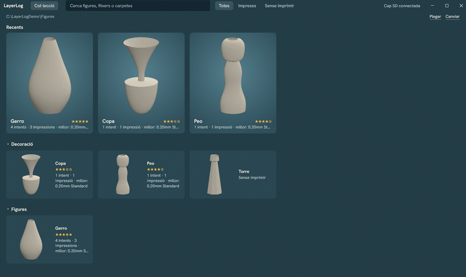

# LayerLog

A Windows desktop viewer for your 3D-printing models, with a history that remembers exactly how each figure was printed.



*Demo with original generated models and sample notes; the settings are made up and not from a real print.*

Tuning a slicer until a figure comes out right takes a lot of trial and error, and that knowledge gets lost between changing profiles and loose gcode files on SD cards. LayerLog reads the gcode already on your cards and keeps, for each one, the settings used and what you changed from the base profile.

## Features

The interface is in Catalan; the names below are its own.

- **Collection (Col·lecció):** every figure in your model folder as a card with its picture, name and how it went (attempts, prints, best rating). Recents first, then one collapsible section per folder. The folder and the last figure are remembered, and models are refreshed without reopening.
- **Search and filters:** `Ctrl+K` searches figures, files and folders. Filter by All, Printed (*Impreses*) or Not printed (*Sense imprimir*).
- **Names and parts:** a figure is named after its file. Rename it (`F2`) and the name follows the model if you move it. Mark pieces as parts (`P`) to hide them from the grid; nothing is guessed from file names.
- **Figure:** a full-window 3D scene with a side panel. It opens on *El que va funcionar*, the best-rated print with its note and what you changed, followed by the other attempts.
- **Attempts (intents) and prints:** each gcode is an attempt, and one attempt can have many prints, each with a date, a rating, a note and a photo.
- **Automatic history:** plug in an SD card and new gcode is imported on its own. Cards are told apart by volume serial, and the same file on two cards counts once. Nothing on the card is ever modified.
- **What you changed:** process and filament settings are compared with the base Creality Print profile, so only your changes are shown. The full configuration is one click away.
- **Compare:** from any attempt, pick another one of the same figure, or any other gcode, and see only the differences. An approximate comparison or a missing base profile is said so.
- **No figure (Sense figura):** gcode whose model is not in the folder is listed here instead of being lost. Open one and point to its model to assign it.
- **Send to Creality Print:** open one figure, or several marked with `Space`, in the slicer.
- **Keyboard:** everything above works without the mouse.

| Key | Action |
|---|---|
| `Ctrl+K` | Search (from a figure, goes back to the collection first) |
| Arrows, `Enter` | Move between cards, open a figure (from the search box, `Down` or `Enter` goes to the results) |
| `Space` | Mark a card to send |
| `F2` / `P` | Rename a figure / mark it as a part |
| `Ctrl+Enter` | Send to Creality Print |
| `Esc` | Go back one step, or clear the search |

3MF files can be listed and sent to Creality Print, but not previewed yet.

## Run it

Requires Windows and the [.NET 10 SDK](https://dotnet.microsoft.com/download/dotnet/10.0). Importing needs gcode from Creality Print 7.x.

```bash
dotnet run --project src/LayerLog.App
```

```bash
dotnet test
```

Data lives in `%LOCALAPPDATA%\LayerLog`. The first run opens `Documents\Impresora3D` if it exists, and asks for a folder otherwise. Set `LAYERLOG_DATA` to another folder to run with separate data and no SD card detection.

## How it is built

| Project | Responsibility |
|---|---|
| `src/LayerLog.Core` | Everything testable, with no UI: gcode and STL parsing, profile inheritance, settings diffs, the figure catalog and search, the SQLite repository and the importer. |
| `src/LayerLog.App` | WPF and MVVM (CommunityToolkit.Mvvm), HelixToolkit.Wpf.SharpDX for 3D, and SD card detection. |
| `tests/LayerLog.Core.Tests` | xUnit tests over fixtures trimmed from real gcode. |

A few decisions worth a look:

- **Config comes from the gcode itself.** Creality Print writes about 600 settings at the end of each file, so history needs no integration with the slicer.
- **Each entry stores its own comparison.** Profiles change over time and between versions, so results are frozen at import. If the exact profile version is not on disk, the nearest one is used and the entry says so.
- **Interrupted imports are safe.** Card locations are replaced only after a full pass, so pulling a card out mid-import loses nothing.
- **Large models and folders stay smooth.** A 1 million triangle STL orbits at 145 FPS on an RTX 5060 Ti. The grid is virtualized and files are parsed off the UI thread, so a folder of 1,000 models shows its first screen in about two seconds and scrolls without stalls while thumbnails fill in, cached on disk after the first time.

`docs/superpowers` holds the design document and the implementation plan.
